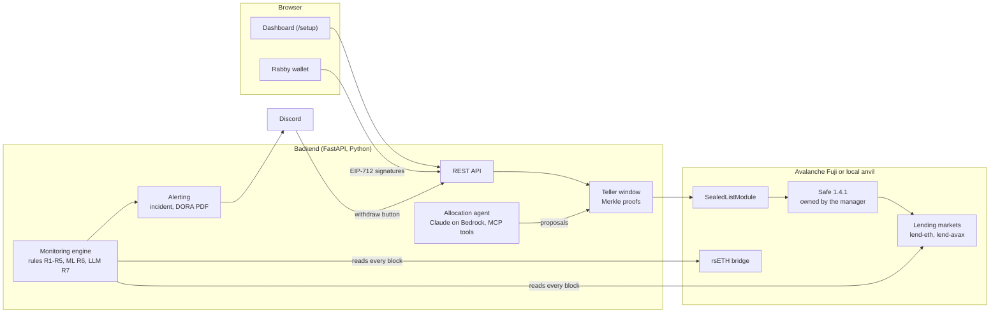

# Secure Horizons · Treasury Guard

[](https://github.com/MelissaAbider/Secure_horizons/actions/workflows/ci.yml)

**Delegate DeFi treasury management to an AI agent without giving it the keys, and get out before an exploit traps your funds.**

> *Allowed is not safe.* In April 2026, a forged cross-chain release minted unbacked rsETH, which was posted as collateral to drain lending markets. Treasuries that were allowed to be there could not withdraw. Treasury Guard seals what a treasury may do, watches what it is exposed to every block, and turns the first fraud signal into a decision, an alert and a regulatory draft within seconds.

Built for the Secure Horizons hackathon, Track 1 "Guardians of Value", October 2026. Runs on **Avalanche Fuji** (testnet) and on a **local anvil chain**. Synthetic data only.

---

## What it does

| Capability | How |
|---|---|
| **Sealed list** | A real Safe 1.4.1, owned by the asset manager's wallet. The manager ticks the markets the treasury may use and signs one Merkle root (EIP-712, in Rabby). A Safe module, the *teller window*, executes only operations that prove membership in that root: CALL only, recipient pinned to the Safe. |
| **Monitoring** | Every block, three independent layers watch the Safe's positions and the markets behind them: deterministic rules R1–R5 (bridge conservation, collateral surge, liquidity drain, exitability, containment), an ML anomaly model (R6) and an LLM review (R7). A consensus step keeps the rules authoritative and caps the non-deterministic layers. |
| **Response** | The first high or critical signal opens an incident and sends **one** Discord summary with the DORA draft attached. When the Discord bot is configured, the summary carries withdraw buttons that pull positions back to the Safe through the sealed list. |
| **DORA draft** | Each incident is classified against RTS (EU) 2024/1772, with deadlines from Regulation (EU) 2025/301, and rendered as a PDF for human review. Nothing is filed automatically. |
| **Allocation agent** | Claude on Amazon Bedrock reads markets, portfolio and alerts through MCP tools and proposes moves. The platform re-reads the chain and the guaranteed rules: inside the list and the caps it executes, above a threshold a human signs, otherwise it refuses. The agent holds no key. |
| **Attack replay** | One click replays the April 2026 attack on the test markets (forged release, fake collateral, drain, freeze), with every step linked on the explorer. |

## Architecture



### Security model

- **The agent proposes, never signs.** It has no key. Its proposals go through the same checks as any other request (`docs/product/INVARIANTS.md`).
- **The owner signs, the platform relays.** Enabling the module and sealing the list are Safe transactions signed in the owner's wallet. The backend verifies the signer, then relays and pays the gas.
- **The teller window cannot be widened.** Only the Safe can set the root, and only the operator can call the module. The module makes plain CALLs with no native value and never targets the Safe or itself. Every sealed operation pins its addresses, so the recipient is always the Safe. Even a leaked operator key can only move funds between the Safe and a sealed market.
- **Detection cannot act on its own.** The deterministic rules are authoritative. ML and LLM signals are capped at "high", and are downgraded to "warning" unless another layer corroborates them. No alert, prompt or chat message can change a right.
- **Secrets stay out of the repository.** Keys live in `.env` (git-ignored), a `gitleaks` pre-commit hook is configured (`pre-commit install`), and the APIs never return secrets.

## Quickstart

**Prerequisites:** Python 3.11, Node.js 20+, [Foundry](https://getfoundry.sh), and for the dashboard flow the [Rabby](https://rabby.io) browser wallet with testnets enabled. Your wallet needs no funds: it only signs.

```bash
git clone https://github.com/MelissaAbider/Secure_horizons.git && cd Secure_horizons
make setup                      # Python venv, git submodules (forge-std, Safe 1.4.1), dashboard dependencies
cp .env.example .env
```

### Local chain (no secret needed)

Every role uses anvil's public test accounts.

```bash
make chain                                    # terminal 1: anvil
NETWORK=local make deploy seed                # terminal 2: test contracts and the reference market state
NETWORK=local make live                       # terminal 2: API on :8000 with the monitoring engine
make frontend                                 # terminal 3: dashboard on http://localhost:5173
```

### Avalanche Fuji

1. Fill the test-network keys in `.env`. Every variable is documented in [`.env.example`](.env.example).
2. Run `make live` and `make frontend`. The shared Fuji contracts are listed in [`deployments/fuji.json`](deployments/fuji.json).

### Demo walkthrough (`http://localhost:5173/setup`)

1. **Connect your Safe.** Connect Rabby. The platform creates a Safe you alone own, credits test tokens, and you sign once to enable the module.
2. **Choose your protocols.** Tick integrations (for example `lend-weth on Ethereum`) and sign the Merkle root.
3. **Set your agent and start monitoring.**
4. **Allocate.** Deposit WETH on `lend-weth on Ethereum` through the teller window.
5. **Launch the attack on Fuji.** The forged release is flagged within a few blocks, your position is shown as stuck, the incident and DORA PDF are created, and the Discord summary is sent.
6. **Reset the test network** to replay. **Disconnect** to start over with another wallet.

## Commands

| Area | Command |
|---|---|
| Setup | `make setup`, `make t1-build` |
| Contracts | `make chain`, `make deploy` (`FORCE=1` to redeploy Fuji, `RESUME=1` after an interrupted run), `make abi`, `make fund-roles` |
| Scenario | `make seed`, `make attack [SEED=n VARIANT=default\|slow\|usdc]`, `make normal MINUTES=n`, `make reset` |
| Run | `make live` (real data), `make backend` (`.env` settings), `make frontend`, `make watch` (engine in a terminal) |
| Sealed list (CLI) | `make seal-deploy`, `make seal PROTOCOLS=…`, `make seal-show`, `make seal-demo` |
| Agent | `make agent-once`, `make agent-tools`, `make agent-mcp` |
| Quality | `make lint`, `make test`, `make test-tN` (one suite) |

`make help` lists every target. `NETWORK` comes from `.env`, and the command line wins: `NETWORK=local make …`.

## Testing and CI

- `make lint`: ruff (pyflakes and syntax) on the Python code.
- `make test`: every suite.
  - Contracts: Foundry, including the module against the real Safe 1.4.1.
  - Backend, scenario and agent: pytest.
  - Dashboard: typecheck, build, Vitest.
  - On-chain suites run when `NETWORK=local`, anvil is up and `make deploy` has run; otherwise they skip.
- **CI** (GitHub Actions, `.github/workflows/ci.yml`): on every pull request and push to `main`, runs `make setup`, `make lint`, anvil + `make deploy`, then `make test` with the on-chain suites. No secret is required.

## Repository layout

```
backend/        FastAPI app: monitoring engine, rules, consensus, alerting, DORA, agent, API routes, tests
contracts/      Solidity (Foundry): test markets, rsETH bridge, vault, SealedListModule; deploy scripts
scenario/       Seed, attack replay, normal traffic, reset
sealed/         Sealed list tooling: Merkle tree, Safe transactions, teller window, dashboard flow
frontend/       Dashboard (React, Vite, Tailwind)
evaluation/     ML dataset builders and model search for the anomaly layer
fixtures/       API fixtures generated from backend/models.py (fixture mode, tests)
deployments/    Deployed addresses per network (fuji.json is shared)
abi/            Contract ABIs used by the backend
docs/           Product, plan and feature documentation (index: docs/README.md)
mk/             Make targets per area, included by the root Makefile
```

## Documentation

- [`docs/README.md`](docs/README.md): documentation index.
- [`docs/product/STATUS.md`](docs/product/STATUS.md): current status and validated runs.
- [`docs/product/INVARIANTS.md`](docs/product/INVARIANTS.md): security and product invariants.
- [`docs/tasks/T10.md`](docs/tasks/T10.md): sealed list and dashboard flow.
- [`docs/agent.md`](docs/agent.md): allocation agent.
- [`docs/discord-actions.md`](docs/discord-actions.md): Discord withdraw buttons.
- [`TASKS.md`](TASKS.md): the full MVP plan and interface contract.
- [`AGENTS.md`](AGENTS.md): rules for coding agents working in this repository.

## Status and roadmap

The MVP runs end to end on Fuji and on a local chain. Next:
- **Hosted deployment on AWS**, with secrets in SSM Parameter Store and a dedicated team deployer key.
- **Agent hardening:** guaranteed rules enforced server-side on every path.
- **Evaluation metrics on replayed runs**, including the April 2026 incident on mainnet data.
- **Jury deliverables.**

Details: [`docs/product/STATUS.md`](docs/product/STATUS.md).

## Disclaimer

Hackathon prototype for testnets only. The contracts are not audited, every market and token is a test deployment, and nothing here is financial advice.
